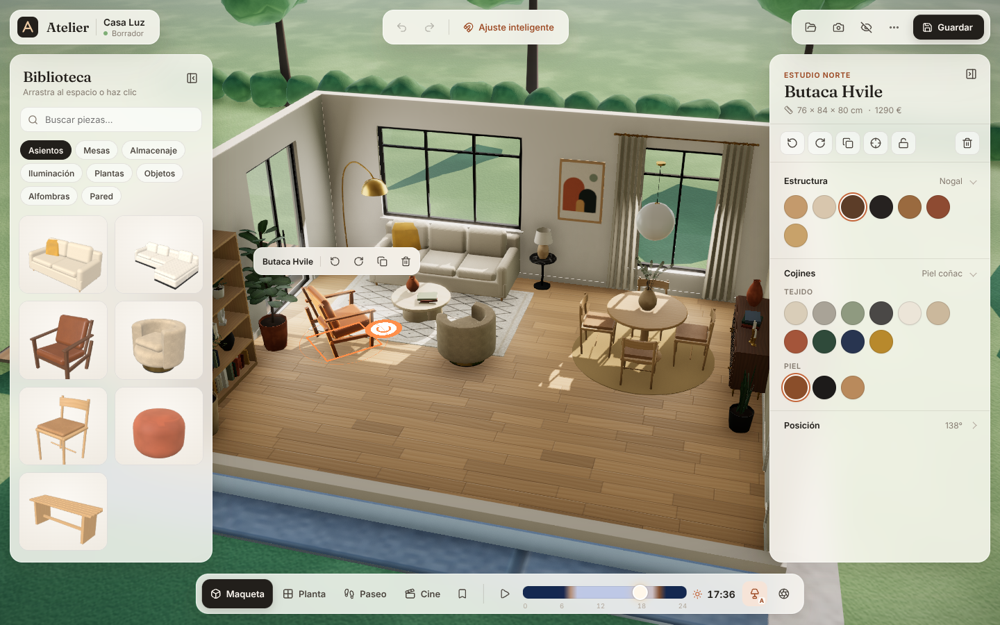

# Atelier — Estudio de interiores 3D

Aplicación web para diseñar un salón-comedor en 3D en tiempo real: amueblar, probar acabados,
ver cómo cambia la luz a lo largo del día, recorrer el espacio y guardar cada versión del diseño.



## Qué se puede hacer

| | |
|---|---|
| **Amueblar** | 41 piezas modeladas proceduralmente (asientos, mesas, almacenaje, lámparas, plantas, objetos, alfombras, cuadros, espejos, cortinas…). Clic en la biblioteca para colocar en un hueco libre, o arrastrar directamente a la escena. |
| **Mover, girar, duplicar, eliminar** | Arrastrar piezas, anillo de giro con asa (pasos de 15°), barra contextual flotante, atajos (`Q/E/R`, `Ctrl+D`, `Supr`, flechas para desplazar 5 cm / 1 cm). Bloqueo de posición. |
| **Sin intersecciones** | Colisiones 2.5D exactas (OBB con SAT + bandas verticales): los muebles no atraviesan paredes, otros muebles ni el paso de las puertas. Al arrastrar contra un obstáculo la pieza *se desliza* a lo largo de él; si se suelta en un sitio imposible vuelve a la última posición válida. |
| **Colocación inteligente** | Cada pieza sabe dónde vive: suelo, pared, techo, alfombra o **sobre otros muebles** (los jarrones se apoyan en mesas, aparadores, estantes de la librería; al mover el mueble, lo que tiene encima viaja con él). Ajuste a pared (enrasado), orientación automática de sofás/librerías contra la pared, guías de alineación entre piezas, cuadros centrados sobre muebles, evitar ventanas. Modos *inteligente / rejilla 10 cm / libre* (`G`, o `Mayús` al arrastrar). Las sillas de comedor se meten bajo la mesa; las cortinas se centran solas sobre las ventanas. Mientras arrastras, **cotas en vivo** con la distancia a las paredes; en el inspector se puede teclear la posición exacta (X, Z, giro, altura). |
| **Materiales y acabados** | ~95 materiales PBR con texturas procedurales (roble, nogal, espiga, terrazo, mármoles, travertino, cal, ladrillo encalado, zellige, listones, lino, bouclé, terciopelo, piel, latón…). Cada pieza tiene ranuras (tapicería, patas, sobre…) y tamaños. Suelo, cada pared, techo, rodapiés y carpintería son editables (clic en la superficie). |
| **Hora del día** | Sol físico (cielo de Preetham con nubes, temperatura de color, sombras suaves), luz cenital entrando por cada ventana, luna y estrellas, rebote de luz interior por sonda de entorno, lámparas que se encienden solas al anochecer (o forzadas), regulador por lámpara, orientación de la vivienda y exposición. Reproducción del paso del día (`Espacio`). |
| **Cámaras** | *Maqueta* (vista de casa de muñecas con muros recortados automáticamente), *Planta* (cenital), *Paseo* (primera persona con colisiones, WASD), *Cine* (6 planos con movimiento, bandas panorámicas y recorrido automático). Transiciones suaves; doble clic o `F` encuadra una pieza; volver a pulsar el modo recentra; vistas guardadas por proyecto. Los muros que miran a la cámara se recortan junto con lo que cuelga de ellos. |
| **Deshacer / rehacer** | Historial completo (120 pasos) con etiquetas descriptivas; cada arrastre cuenta como un único paso. |
| **Guardar y recuperar** | Autoguardado continuo, proyectos con miniatura en el navegador, renombrar/eliminar, exportar e importar JSON (validado y reparado al cargar), 3 plantillas de estilo + lienzo vacío. |
| **Capturas limpias** | `H` oculta toda la interfaz; `P` exporta un PNG a doble resolución sin overlays. |
| **Escritorio y móvil** | Interfaz adaptable: en móvil la barra se compacta, el dock pasa a dos filas y los paneles son hojas inferiores. |

## Desarrollo guiado por specs

El comportamiento está especificado en [`specs/`](specs/README.md) (requisitos con ID anclados al
código y a los tests) bajo la [constitución](constitution.md). `npm run verify` comprueba tipos,
tests, trazabilidad de specs y build. Guía para agentes: [`CLAUDE.md`](CLAUDE.md).

## Ejecutar

```bash
npm install
npm run dev        # http://localhost:5173
npm run build      # build de producción en dist/
npm test           # pruebas unitarias (placement, historial, persistencia, catálogo…)
npm run spec:check # trazabilidad specs ↔ código/tests
npm run verify     # typecheck + test + spec:check + build
npm run test:e2e   # pruebas de interacción en Chromium (requiere `npm run dev` en otra terminal)
```

Parámetros útiles: `?fixedpr=1` fija el *pixel ratio* (desactiva la resolución adaptativa).

## Arquitectura

```
src/
  core/        Lógica pura, sin WebGL (testeable en Node)
    types.ts         Modelo del documento (DesignDoc, ItemInstance…)
    room.ts          Arquitectura: muros, vanos, coordenadas de pared
    catalog.ts       Catálogo: dimensiones, variantes, ranuras de material, colisionadores, superficies, luces
    materials.ts     Biblioteca de materiales (datos)
    geometry.ts      OBB 2.5D, SAT con vector de traslación mínima
    placement.ts     Reglas de colocación: suelo, pared, superficie, techo, snapping, búsqueda de huecos
    persistence.ts   localStorage, export/import y saneado de documentos
    presets.ts       Plantillas de diseño
  state/store.ts     Zustand: documento inmutable + historial, selección, entorno, cámara, UI
  engine/      three.js (imperativo; sólo lee el store)
    Engine.ts        Renderer, bucle, sincronización con el store, resolución adaptativa, capturas
    RoomShell.ts     Muros extruidos con vanos reales, carpintería, rodapiés, recorte de muros, jardín
    Lighting.ts      Modelo solar, cielo, sol/luna, luces de ventana, sonda de entorno interior
    ItemLayer.ts     Documento → objetos 3D (reconstrucción sólo cuando cambia tipo/material/tamaño)
    builders.ts      Modelado procedural de cada pieza + fusión de mallas y UV métricas
    textures.ts      Síntesis de texturas tileables (color, normal, rugosidad)
    texturePool.ts   Pool de Web Workers que genera las texturas en paralelo
    MaterialLibrary  Materiales PBR compartidos, cola de texturas, muestras para la UI
    Interaction.ts   Picking, arrastre con reglas de colocación, asa de giro, arrastrar desde la biblioteca
    CameraRig.ts     Modos de cámara, transiciones, paseo, planos cinematográficos
    PostFX.ts        N8AO (oclusión ambiental), bloom, ACES, gradación, viñeta, SMAA
    Highlight.ts     Brillo de borde (fresnel) para selección y hover
    Overlays.ts      Huella, anillo de giro, guías de alineación, cotas
    Thumbnails.ts    Miniaturas de la biblioteca renderizadas con los modelos reales
  ui/          React: barra superior, biblioteca, inspector, dock, modales, atajos
```

**Decisiones clave**

- *Documento inmutable*: cada edición produce un documento nuevo; deshacer es cambiar de referencia. Los arrastres usan "gestos" (`beginGesture/preview/endGesture`) para que todo el movimiento sea un único paso.
- *Reglas de colocación puras* en `core/`, sin dependencias de WebGL: el motor y los comandos de teclado comparten la misma lógica, y está cubierta por pruebas.
- *Sin assets externos*: geometría y texturas se generan en el navegador de forma determinista (texturas en un pool de *workers*, sin bloquear la interfaz); la app funciona offline y pesa ~570 KB gzip.
- *Iluminación creíble y barata*: sombras PCF suaves del sol, `RectAreaLight` en cada ventana, una sonda cúbica del propio interior (prefiltrada con PMREM) que aporta rebote de luz con el color de las paredes, y un entorno de cielo separado para el jardín.
- *Recorte de muros*: los muros que miran a la cámara se ocultan pero siguen proyectando sombra (material sin escritura de color/profundidad), dejando un zócalo de referencia.
